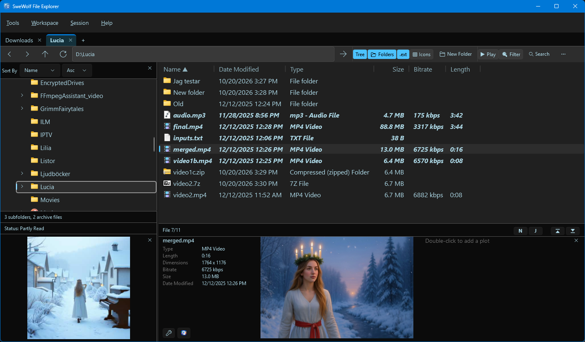

# SweWolf File Explorer

A Windows file manager with tabs, a folder tree, bookmarks and an information panel. It copies, moves and deletes in the background with a progress window and **Cancel**, takes back your last file operation with **Ctrl+Z**, looks inside zip, RAR and 7z files like folders, and remembers what you have read, rated and tagged.



---

## Features

- **Tabs, workspaces and sessions**: open several folders in tabs, save the open tabs as a **workspace**, or let a **session** remember them all the time. Saved ones are listed in the **Workspace** and **Session** menus and managed in their own windows (rename, shortcut, move to a USB stick)
- **Folder tree** with **Bookmarks** (folders, files, web addresses; groups are sub-folders), the usual places, **This PC** with a list of your drives, and a tree root you can set to any folder
- **Fast and safe file work**: copy, move and delete run in the background with progress, **Cancel**, and a clear question when a name is taken (**Replace**, **Keep Both**, **Keep Both, Rename Old**, **Skip**). Identical files are not copied again. Files go to the Recycle Bin, and the question says when something cannot
- **Search** (**Ctrl+Shift+F**): find files and folders in any folders or all drives, by name (words, `*` and `?`, "phrases", approximate matching), type, date, size and hidden state. Results stream into a new tab, with a **Location** column and a list of folders to skip
- **Icons view**: show the files as tiles with pictures, covers and video thumbnails (one size, **Ctrl + wheel** to change it)
- **Protected folders**: copy, delete, rename and create in a folder such as Program Files by continuing as the administrator, after Windows' own question
- **Undo** (**Ctrl+Z** or the button in the information line): delete, rename, move, copy and new folder or file, one step back. Nothing is overwritten or guessed
- **Drag and drop** to and from other programs, with the right-button menu (**Copy Here**, **Move Here**, **Create Shortcut Here**). A file dropped on a program starts it, after a security question
- **Archives as folders**: zip, cbz, RAR, cbr, 7z, cab, tar and gz are read in place, also inside each other. 7-Zip is used for the formats that .NET cannot read
- **Audio CDs**: titles, artists and the cover come from MusicBrainz, and **Rip** saves the tracks as MP3, FLAC or M4A (checked by reading each track twice). **Eject** is in the drive's menu
- **Pictures**: a full-screen viewer with slide show, zoom, rotation that can be saved, and next-folder browsing. It shows JPEG, PNG, GIF (animated), WebP, SVG, Photoshop (PSD, PSB), JPEG XL and the previews inside NEF and DNG photos
- **Video and music** play in **SweWolf Media Player** when it is found (in the same folder as the Explorer, or in a sibling folder called `SwewolfMediaPlayer`). Otherwise Windows' own program is used. The **Play bar** plays a whole list (slide show, repeat, demo, intro or random order), and M3U playlists open like folders and can be edited. Tracks of an audio CD (`.cda`) play too
- **Information panel**: a preview, details of the file, the plot from a Kodi or Jellyfin `.nfo` file (which you can edit, view as a web page, or download from TMDB with your own free key), prompt and seed of AI pictures (ComfyUI, Automatic1111, Wan2GP), a map pin for pictures and videos with a position, and where a downloaded file came from
- **Read marks, ratings and tags**: unread files are shown in bold, you give files and folders a rating (1 to 10) and an expectation, folders can have tags. This is kept in SQLite files, and on a USB drive it travels with the drive
- **Columns and sorting per folder**, with columns that fit their text, and extra columns such as length, bitrate, dimensions and product version
- **Filter** the list as you type (**Ctrl+F**), **type-ahead** in the list and the tree, and a forgiving address bar that understands quotes, `d:/folder`, `%APPDATA%` and `shell:startup`
- **Related files follow**: when you rename or move a video or music file, its subtitles, poster and `.nfo` file can come along
- **Safety**: a security question before a program starts, and **Send to VirusTotal** (a hash lookup, or an upload if you add your own free API key)
- **Looks and menus**: Light, Dark, System and **Cyber Cyan** styles, your own names and icons for file types, and a choice of which right-click menu items are shown
- **Help** (**Help > SweWolf File Explorer Help**, F1): a complete user guide

---

## Requirements

- **Windows 10 / 11**, 64-bit
- **.NET 10 Desktop Runtime** ([download](https://dotnet.microsoft.com/download)), unless you use the standalone EXE, which needs nothing installed
- Optional, each adds something:
  - **SweWolf Media Player** for video and music
  - **7-Zip** for RAR, 7z, cab and tar files
  - **FFmpeg** (`ffmpeg.exe` next to the application or on the PATH) for a preview frame of videos Windows cannot show
  - **ImageMagick** for HDR JPEG XL pictures (without it, Windows' own codec is used)

---

## Usage

Start the program and open a folder in the tree or type its path in the address bar (**F6**). Double-click opens a file, **F2** renames, **Delete** deletes, **Ctrl+C**, **Ctrl+X** and **Ctrl+V** work as in Windows Explorer, and **Ctrl+Z** takes back the last operation. Right-click anything for its menu, and **More Options** shows the full Windows menu.

For all the details, press **F1** in the application or see [docs/help.md](docs/help.md).

### Command Line

```
SwewolfFileExplorer.exe "D:\Photos"               opens the folder, as the top of the tree
SwewolfFileExplorer.exe "D:\Photos\a.jpg"         shows the picture in the viewer only
SwewolfFileExplorer.exe "D:\Music\song.mp3"       opens the folder and selects the file
SwewolfFileExplorer.exe "C:\...\My Session.json"  opens a saved workspace or session
SwewolfFileExplorer.exe /select,"D:\Music\song.mp3"  opens the folder and selects the item, as Windows Explorer does
```

---

## Built With

- [.NET 10 / WPF](https://dotnet.microsoft.com/)
- [TagLibSharp](https://github.com/mono/taglib-sharp): tags, covers and lengths of music, video and pictures
- [Microsoft.Data.Sqlite](https://learn.microsoft.com/dotnet/standard/data/sqlite/): read marks, ratings and folder settings
- [Svg.Skia](https://github.com/wieslawsoltes/Svg.Skia) and [SkiaSharp](https://github.com/mono/SkiaSharp): SVG pictures
- [Pandoc](https://pandoc.org/): builds the help file from Markdown

---

## License

[MIT License](LICENSE)

---

*Developed by [SweWolf](https://github.com/SweWolf)*
